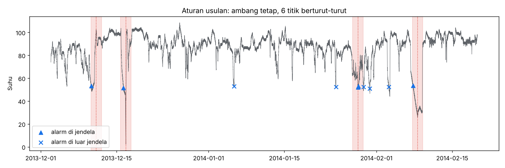

# Aturan alarm usulan

**Aturan:** kirim alarm jika suhu menyimpang lebih dari **35 derajat** dari median data latih selama **6 titik berturut-turut** (30 menit). Satu episode ditutup setelah 1 jam tanpa alarm.

Ambang dan persistence dipilih dari data sebelum 2014-01-01 saja, dengan batas alarm palsu 2,0 per minggu (asumsi, belum disepakati dengan tim maintenance).

## Hasil
| Periode | Kejadian terdeteksi | Peringatan dini | Alarm palsu per minggu | Precision (episode) |
|---|---|---|---|---|
| Latih | 2 dari 2 | 2 | 0,00 | 1,00 |
| Uji | 2 dari 2 | 1 | 0,70 | 0,38 |
| Semua | 4 dari 4 | 3 | 0,45 | 0,50 |

## Lead time per kejadian (jam; negatif = setelah perkiraan waktu kegagalan)
| Jendela | Titik tengah (perkiraan kegagalan) | Alarm pertama | Lead time |
|---|---|---|---|
| 1 | 2013-12-11 06:00:00 | 2013-12-10 07:45:00 | 22,2 |
| 2 | 2013-12-16 17:25:00 | 2013-12-16 06:45:00 | 10,7 |
| 3 | 2014-01-28 13:55:00 | 2014-01-28 14:00:00 | -0,1 |
| 4 | 2014-02-08 14:30:00 | 2014-02-07 18:05:00 | 20,4 |

## Alasan dan batasan
- Aturan paling sederhana mengalahkan rolling z-score dan Isolation Forest pada data ini; lihat `results/2-analysis/selection_best_per_method.csv`.
- Hanya 4 kejadian (2 latih, 2 uji): kesimpulan bersifat indikatif, bukan bukti umum.
- "Alarm palsu" adalah alarm di luar jendela berlabel; sebagian bisa gangguan nyata yang tidak dilabeli NAB.
- Titik tengah jendela hanyalah pendekatan waktu kegagalan.
